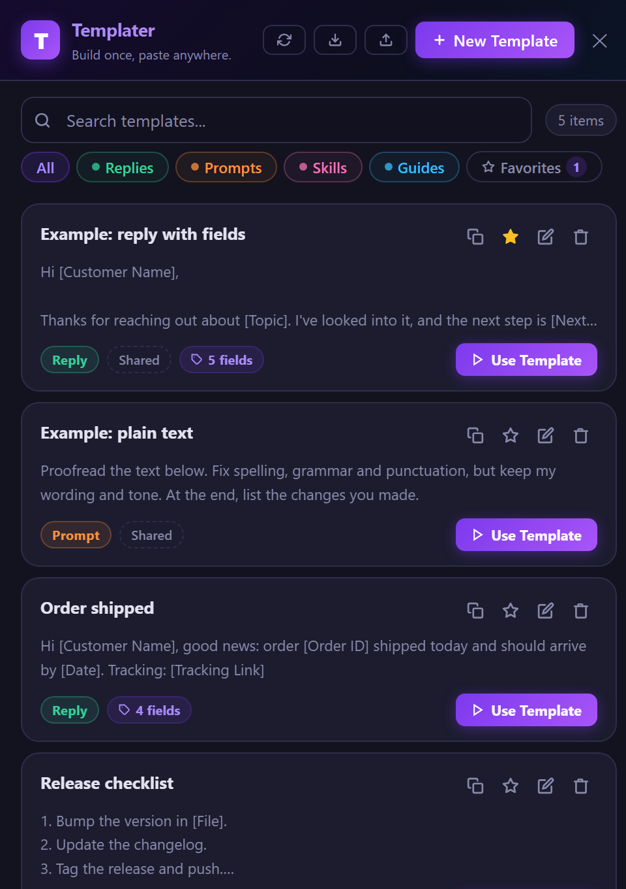
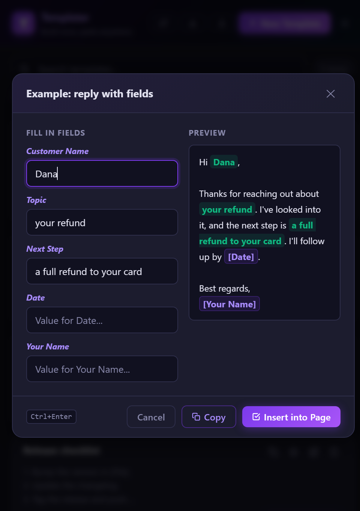

# Templater

**Build once, paste anywhere.** Save the messages you type over and over, mark the parts that change with `[Fields]`, and fill them in when you paste. Works as a Chrome extension and as a VS Code extension, and can keep a shared template library in sync from a public Git repo.

[](https://github.com/henperets/templater-snippets/actions/workflows/ci.yml)
[](LICENSE)

<p align="center">
  
  &nbsp;
  
</p>

## Why

Anyone who answers the same questions all day (support, sales, ops, engineering) ends up retyping near-identical messages, or hunting through old chats for "that reply I wrote last month". Templater keeps those replies one click away, and the `[Field]` placeholders make sure the details (customer name, date, order number) are filled in correctly every time.

## Features

- **Dynamic fields:** write `Hi [Customer Name], your order [Order ID] ships on [Date].` and Templater turns each `[Field]` into an input, with a live preview.
- **Four categories, each with its own color:** Replies (answers for clients), Prompts (for AI assistants), Skills (reusable instructions) and Guides (step-by-step how-tos).
- **Search and favorites:** search by name or content, and pin the ones you use most.
- **Two front-ends, one data model:**
  - **Chrome extension:** a floating panel on any page. Copy the result, or insert it into the field you were typing in.
  - **VS Code extension:** a panel that can insert the result straight into the editor.
- **Shared library via Git:** keep your templates in a public repo as one `templates.json`. Everyone who installs the extension gets updates automatically, with no manual export/import. See [How sync works](#how-sync-works).
- **Right-to-left friendly:** handles Hebrew and other RTL text.
- **No accounts, no tracking, no build step.** Plain JavaScript with zero runtime dependencies.

## Install

### Chrome (or any Chromium browser)

1. [Download the ZIP](https://github.com/henperets/templater-snippets/archive/refs/heads/main.zip) and unzip it, or clone the repo.
2. Open `chrome://extensions` and turn on **Developer mode**.
3. Click **Load unpacked** and select the project folder (the one that contains `manifest.json`).
4. Click the Templater icon on any web page to open the panel.

### VS Code

1. Clone this repo and open it in VS Code.
2. Press `F5` (uses the *Run Extension* launch config) to start an Extension Development Host.
3. Run **Templater: Open Template Manager** from the Command Palette, or press `Ctrl+Shift+Alt+T`.

## Getting started

A fresh install comes with two starter templates, so you can see how it works right away:

| Template | Shows |
|---|---|
| **Example: reply with fields** | A reply with `[Fields]` that you fill in before pasting |
| **Example: plain text** | A template without fields, ready to copy as is |

Click **Use Template** to try them, then delete them or edit them into your own. Click **New Template** to write your first one. Deleting a template always asks for confirmation first.

## How sync works

The shared library is a single file, [`templates.json`](templates.json), in a public GitHub repo. On startup, and when you press **Sync**, the extension fetches the raw file and merges it into your local list.

```text
  you edit in the extension
          │  Export  → templates.json
          ▼
  commit & push to the repo ──► raw.githubusercontent.com ──► every user's extension (auto-sync)
```

Merge rules, all covered by [unit tests](test/sync.test.js):

| Situation | Result |
|---|---|
| New item in the repo | Added to the local list, marked **Shared** |
| Shared item changed in the repo | Updated locally; your favorite flag is kept |
| You edit a shared item | It becomes your own copy and is never overwritten |
| You delete a shared item | It stays deleted on later syncs |
| Item removed from the repo | Removed locally, unless you edited it |
| You own an item with the same id or name | Yours always wins |

### Use your own library, or none

`REMOTE_URL` in [`src/sync.js`](src/sync.js) decides where templates sync from:

- **Share your own templates:** fork this repo, replace `templates.json` with your own (use **Export** in the extension), and point `REMOTE_URL` at your fork's raw file.
- **Keep everything local:** set `REMOTE_URL` to `''`. Sync turns off and the extension makes no network requests.

## Project structure

```text
manifest.json        Chrome extension manifest (MV3)
package.json         VS Code extension manifest and npm scripts
templates.json       Starter library that new installs sync from
src/
  background.js      Chrome service worker: toggles the panel on icon click
  content.js         Injects the floating panel (an iframe) into the page
  popup.html/.js     The Chrome UI (HTML, CSS and logic)
  extension.js       VS Code extension: host logic and the webview UI
  sync.js            Shared-library merge logic, used by both extensions (pure functions)
icons/               Extension icons (PNG sizes and the SVG source)
test/                Unit tests (node:test)
docs/                Architecture notes, privacy policy, screenshots
```

More detail in [docs/ARCHITECTURE.md](docs/ARCHITECTURE.md).

## Development

Requires Node.js 18+ (no install step, there are no dependencies).

```bash
npm test        # unit tests: sync/merge logic and the VS Code webview script
npm run check   # syntax-check every source file
```

## Roadmap

- [ ] Configurable library URL (settings page / VS Code setting)
- [ ] Publish to the Chrome Web Store and VS Code Marketplace
- [ ] Share the UI code between the two front-ends instead of keeping two copies
- [ ] Import/export as Markdown files, one per template
- [ ] Keyboard-only flow for filling fields

## Contributing

Issues and pull requests are welcome. See [CONTRIBUTING.md](.github/CONTRIBUTING.md).

## Privacy and security

Templater collects no data. See the [privacy policy](docs/PRIVACY.md) and [security policy](.github/SECURITY.md).

## License

[MIT](LICENSE) © Hen Perets
